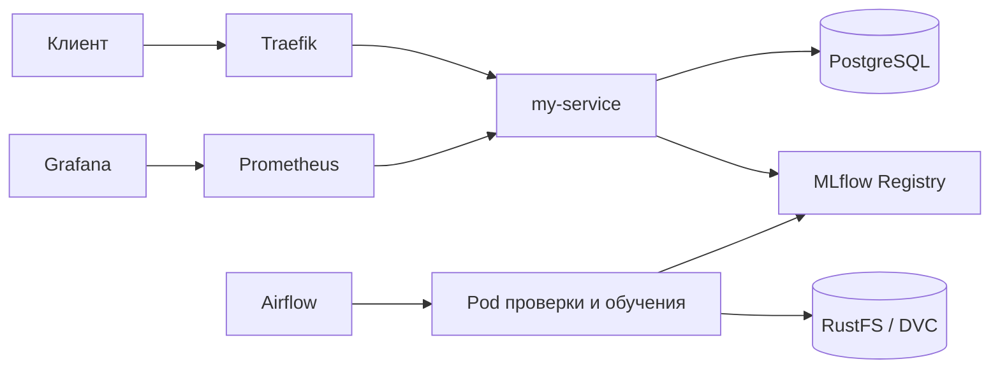
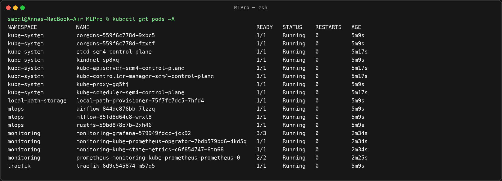
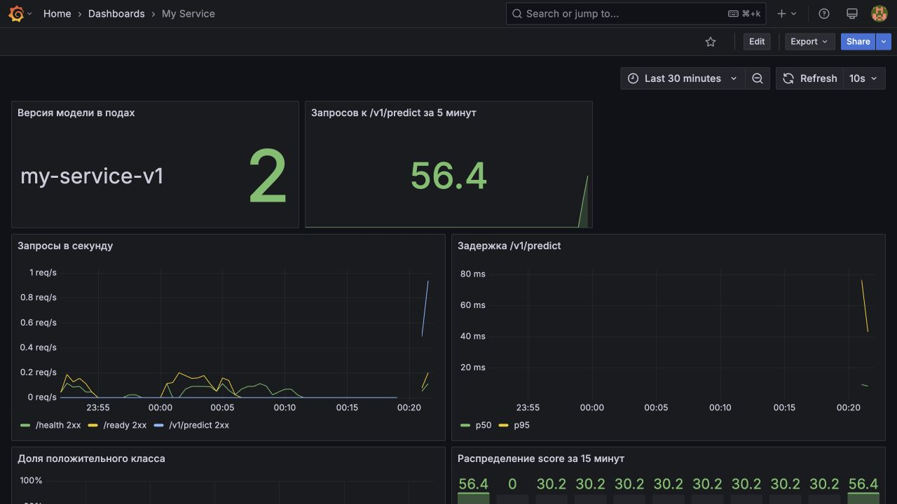
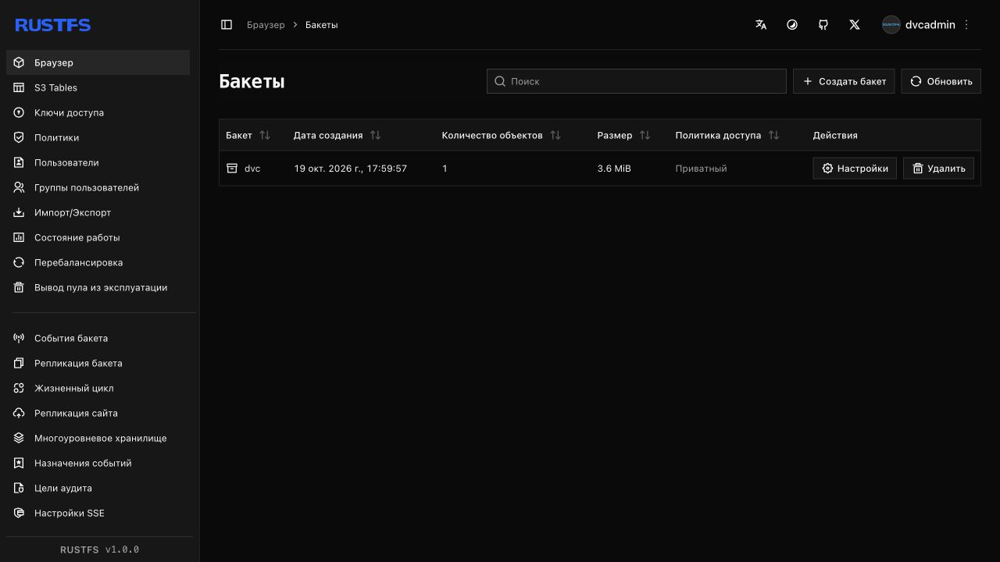
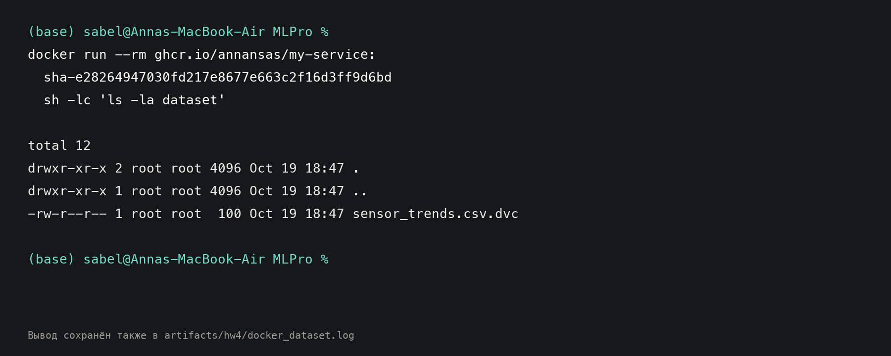
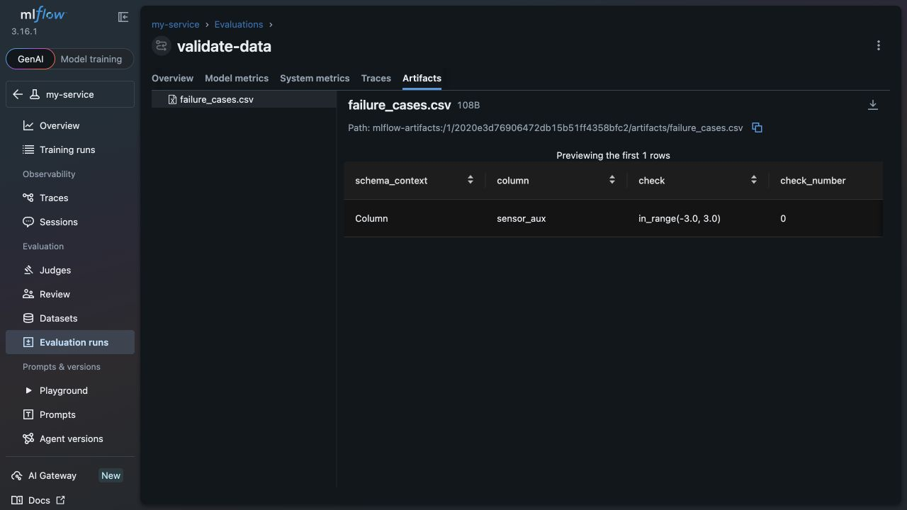
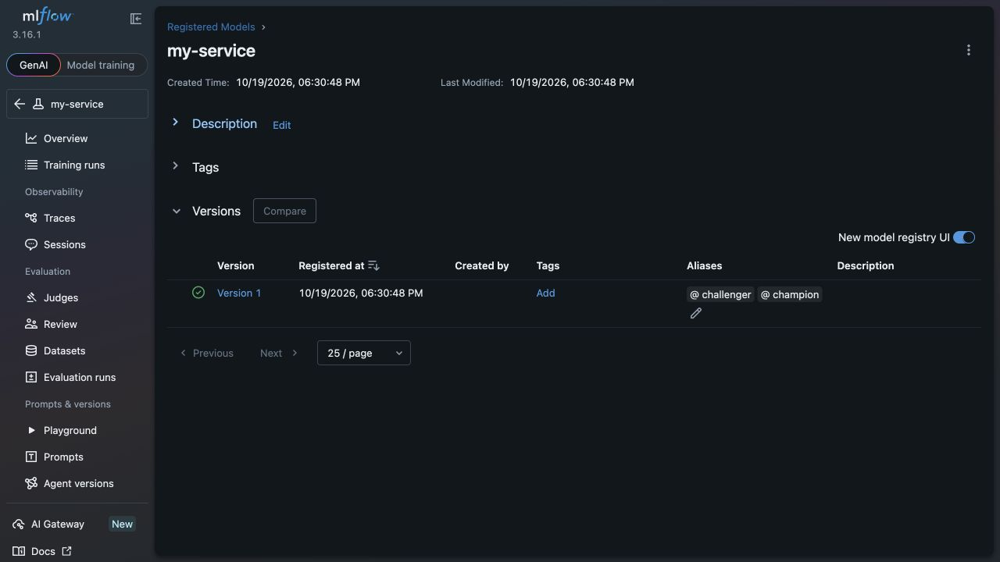
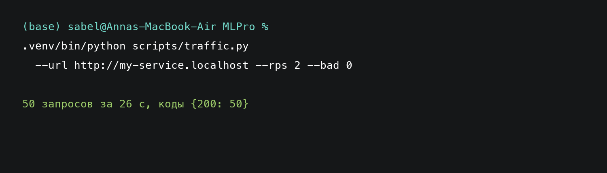

# Отчёт по итоговому проекту

## Выполнение задания

| Пункт задания | Доказательство |
|---|---|
| 1. Платформа одной командой | [`platform/up.sh`](platform/up.sh), [`platform.log`](artifacts/hw4/platform.log), [`kubectl get pods -A`](images/hw4/kubectl_get_pods.png). Чистый запуск `sem4` занял 3 мин 57 с, повторный — 39 с. MLflow, Airflow, RustFS, Traefik, Prometheus и Grafana поднялись, бакет `dvc` создан. |
| 2. Метрики и дашборд | [`dashboard.yaml`](k8s/monitoring/dashboard.yaml), [дашборд под трафиком](images/hw4/grafana_dashboard.png), [чистый трафик](images/hw4/traffic_clean.png), [`traffic_clean.log`](artifacts/hw4/traffic_clean.log). Grafana показывает версию модели, RPS, p50/p95, долю положительного класса и распределение score. Контрольный запуск: 50 ответов из 50 с кодом 200. |
| 3. Данные в DVC и S3 | [`bootstrap_data.py`](scripts/bootstrap_data.py), [`sensor_trends.csv.dvc`](dataset/sensor_trends.csv.dvc), [бакет `dvc`](images/hw4/s3_dvc_bucket.png), [содержимое образа](images/hw4/docker_dataset.png), [`docker_dataset.log`](artifacts/hw4/docker_dataset.log). Скрипт воспроизводит объект с MD5 `3b4320a5898d952f1657acd6663d423a`; Quickstart заполняет пустой бакет и проверяет `dvc pull`. |
| 4. Проверка данных | [`validate_data.py`](src/my_service/validate_data.py), [`test_validate_data.py`](tests/test_validate_data.py), [CI run 39305338626](https://github.com/AnnAnsas/MLPro/actions/runs/39305338626), [`failure_cases.csv` в MLflow](images/hw4/mlflow_failure_cases.png). Локально прошли 25 тестов. Значение `sensor_aux=4.0` дало код 1, тег `valid=false` и артефакт `failure_cases.csv`. |
| 5. Конвейер переобучения | [`my_service_retrain.py`](dags/my_service_retrain.py), [Model Registry с алиасами](images/hw4/mlflow_registry_aliases.png). DAG содержит задачи `validate`, `train`, `promoted`, `rollout`. Два требуемых запуска DAG и доказательства rollout не получены. |
| 6. CI/CD целиком | [Workflow](.github/workflows/ci.yml), [последний полный запуск](https://github.com/AnnAnsas/MLPro/actions/runs/39327974785). Тесты и сборка прошли. Полный deploy с Airflow не завершён; причина и выполненные попытки приведены ниже. |

## Схема платформы

















## Пороги проверки данных

Границы признаков взяты с запасом от наблюдаемых минимумов и максимумов. Доля класса 1 ограничена 45–55%, медиана `sensor_level` — ±0,25, пропуски — 3%: текущие значения равны 49,8%, 0,032 и 1,88% соответственно.

## Почему не выполнены пункты 5–6

На ноутбуке 8 ГБ оперативной памяти, Docker получает 3,83 ГиБ. Для запуска Airflow запрос памяти снижался с 768 до 512 МиБ, число worker и parsing process — до одного, сервис и HPA — до одной реплики; Grafana и Prometheus временно останавливались, Docker перезапускался. Лимит Airflow 1 ГиБ дал `OOMKilled`, поэтому его вернули на 1,5 ГиБ.

Кратковременно все компоненты становились `Ready` при потреблении kind около 3,03 ГиБ, но затем scheduler и controller-manager переходили в `Error`, Ingress отвечал `502/503`, а deploy терял Kubernetes API. Поэтому три сценария DAG не получены, а шаг Airflow удалён из CI ради стабильного деплоя сервиса.

## Переделки

| Пункт обратной связи | Что сделано | Доказательство |
|---|---|---|
| Отчёт должен находиться в `REPORT.md` | Отчёт перенесён в корень репозитория, ссылка в основном README обновлена | [`REPORT.md`](REPORT.md), [`README.md`](README.md) |
| Нужна таблица по каждому «Предъявить» | Для всех шести пунктов указаны файлы, прогоны и снимки; незавершённые результаты отмечены прямо | [таблица выполнения](#выполнение-задания) |
| Не хватало схемы и восьми ответов | Добавлена схема компонентов; ответы собраны в отдельном разделе | [схема](#схема-платформы), [ответы](#ответы-на-вопросы) |
| Нужны снимки дашборда и S3 | Снимки включены в отчёт вместе с исходниками дашборда и журналами проверок | [Grafana](images/hw4/grafana_dashboard.png), [S3](images/hw4/s3_dvc_bucket.png) |
| Quickstart привязан к исходному репозиторию | URL fork задаётся через `REPO_URL`; добавлены настройка `DB_PASSWORD`, создание runner и контрольные команды после клонирования | [Quickstart](README.md#quickstart) |
| Образ собирался только для ARM64 | В GitHub Actions добавлен QEMU; образ публикуется для `linux/amd64` и `linux/arm64` | [Workflow](.github/workflows/ci.yml) |
| Бакет `dvc` в новом кластере пуст | Добавлено воспроизводимое создание требуемой версии данных и цикл `dvc add → push → удаление CSV → pull` | [`bootstrap_data.py`](scripts/bootstrap_data.py), [Quickstart](README.md#quickstart) |
| Перенос на Windows-компьютер | Quickstart дополнен запуском через WSL2, лимитом 8 ГБ, Docker Desktop WSL Integration, проверкой Linux socket и AMD64-образом; для исполняемых файлов закреплены окончания строк LF | [Windows 11 и WSL2](README.md#windows-11-и-wsl2), [`.gitattributes`](.gitattributes) |
| Результат DAG и полный deploy не подтверждены | Ограничение отмечено без заявления о выполнении; сохранены ссылки на имеющиеся прогоны | [DAG](dags/my_service_retrain.py), [CI](https://github.com/AnnAnsas/MLPro/actions/runs/39327974785) |

## Переделки ДЗ 1

Рабочая последовательность после клонирования приведена в [Quickstart](README.md#quickstart) и в [README1.md](README1.md). Команды проверки чистого клона были добавлены в [коммите `5088a45`](https://github.com/AnnAnsas/MLPro/commit/5088a4510c08607f091278671716f051ed357862). Для воспроизведения именно ДЗ 1 после клонирования выбирается этот коммит: более поздние домашние работы меняют конфигурацию сервиса и Kubernetes.

Установка окружения и тесты:

```bash
export REPO_URL='https://github.com/<OWNER>/<REPOSITORY>'
git clone "${REPO_URL}.git" MLPro
cd MLPro
git checkout 5088a4510c08607f091278671716f051ed357862
uv sync --locked
uv run --no-sync python -c "import my_service"
uv run --no-sync pytest
```

Проверка Compose, API и записи в PostgreSQL:

```bash
docker compose config --quiet
docker compose up -d --build --wait --wait-timeout 180
curl --fail --retry 30 --retry-connrefused --retry-delay 2 http://localhost:8000/ready
curl --fail -H 'Content-Type: application/json' \
  --data-binary @example.json http://localhost:8000/v1/predict
sleep 1
docker compose exec -T db psql -U postgres -d postgres -c \
  'SELECT request_id, status_code, score, scores FROM predictions ORDER BY ts DESC LIMIT 5;'
docker compose down
```

Проверка Kubernetes:

```bash
kind create cluster --name mlpro-hw1
docker build -t my_service:1.0 .
kind load docker-image my_service:1.0 --name mlpro-hw1
kubectl --context kind-mlpro-hw1 apply -f k8s/
kubectl --context kind-mlpro-hw1 rollout status deployment/my-service --timeout=180s
kubectl --context kind-mlpro-hw1 get pods,svc
kubectl --context kind-mlpro-hw1 port-forward service/my-service 8001:80 &
forward_pid=$!
trap 'kill "$forward_pid"' EXIT
curl --fail --retry 30 --retry-connrefused --retry-delay 2 \
  -H 'Content-Type: application/json' \
  --data-binary @example.json http://localhost:8001/v1/predict
kill "$forward_pid"
trap - EXIT
kind delete cluster --name mlpro-hw1
```

## Ответы на вопросы

1. **Как воспроизвести версию модели N?** По версии в Model Registry нахожу `run_id`, параметры, метрики и git-коммит запуска. По этому коммиту восстанавливаю код и DVC-указатель, выполняю `dvc pull` и сверяю `data_md5`, `seed`, `epochs` и остальные параметры из MLflow.

2. **Почему данные не лежат в образе?** Датасет исключён из Docker-контекста и хранится в DVC/S3, поэтому образ меньше и данные обновляются независимо от кода. Если выполнить `git push` раньше `dvc push`, в git появится указатель на отсутствующий объект и `dvc pull` в CI или DAG завершится ошибкой.

3. **Чем отличаются бинарные проверки от пороговых?** Наличие колонок, типы, допустимые классы и полные окна — обязательные проверки структуры. Долю классов, медиану и пропуски проверяю порогами, выбранными по текущему датасету с запасом; слишком узкие границы будут отклонять допустимый дрейф данных.

4. **Зачем нужны Pandera и Pydantic?** Pandera проверяет весь обучающий DataFrame, включая статистику и связи между строками. Pydantic проверяет отдельный запрос API: форму последовательности, конечность значений, диапазоны ответа и отсутствие лишних полей.

5. **Почему обучение выполняется в отдельном pod?** Временный pod изолирует ресурсоёмкое обучение от работающего API и удаляется после задачи. После назначения алиаса `champion` образ пересобирать не нужно: rollout перезапускает сервис, а `model_store` загружает новую версию из MLflow Registry.

6. **Какие метрики собираются?** Инфраструктурные метрики показывают CPU, память и состояние pod; сервисные — RPS, ошибки и p50/p95; модельные — версию, долю классов и распределение score. `request_id` не используется как label Prometheus, потому что уникальные значения создадут неограниченную кардинальность; он хранится в PostgreSQL.

7. **Что происходит при rollout?** При двух репликах `maxSurge: 0` не создаёт третий pod, а `maxUnavailable: 1` оставляет доступной минимум одну реплику; суммарный memory request сервиса не превышает 1 ГиБ. `preStop` даёт ingress пять секунд убрать завершающийся pod из маршрутизации; без паузы под нагрузкой появлялись обрывы и ответы `502/503`.

8. **Какой сбой наиболее вероятен в production?** Для текущей конфигурации главный риск — нехватка памяти при одновременной работе модели, Airflow и мониторинга. Его видно по `OOMKilled`, рестартам, недоступности readiness probe и росту `502/503`; первое действие — остановить необязательную нагрузку и проверить потребление памяти и события pod.

## Журнал проблем

| Проблема | Причина | Исправление |
|---|---|---|
| Grafana перезапускалась во время первого старта | Grafana 13 выполняла долгую миграцию SQLite и не укладывалась в стандартное окно liveness на ноутбуке с 8 ГБ | Зафиксирована Grafana 11.6.8, liveness отложена на 300 с, CPU ограничен `500m` |
| После локального обучения kubelet медленно создавал поды | Docker использовал около 3,1 из 3,8 ГБ, macOS активно работала со swap | Для локального обучения временно остановлены Airflow и мониторинг; после обучения платформа восстановлена. Traefik получил ресурсы и менее строгие probe |
| После длительной работы один CoreDNS временно стал `0/1` | Кластер занял около 2,9 из доступных Docker 3,8 ГБ, health-check не успел ответить | CoreDNS перезапущен; для освобождения памяти после проверки кластер останавливается |
| Под трафиком сервис и Grafana потеряли готовность | Две реплики модели, Prometheus, Grafana, MLflow и RustFS вместе превысили доступные Docker 4 ГБ | За 271 с генератор получил 128 ответов `200`, 6 ответов `422`, затем 3 сетевые ошибки, 66 ответов `502` и 47 ответов `503`. Исправление не выполнялось; ограничение честно зафиксировано |
| Локальная сборка образа остановилась после установки 144 пакетов | Docker завис на сохранении тяжёлого слоя с PyTorch при том же лимите памяти | Для проверки использован образ из GHCR: в `dataset` найден только `sensor_trends.csv.dvc` |
| CI остановил deploy при загрузке образа в kind | Импорт образа не уложился в исходный лимит job | Лимит deploy увеличен с 10 до 30 минут |
| Airflow не стал `Ready` в [run 39309559546](https://github.com/AnnAnsas/MLPro/actions/runs/39309559546) | Две реплики сервиса, Airflow и мониторинг перегрузили kind; API Kubernetes перестал отвечать | CI оставляет одну реплику сервиса, запускает Airflow с одним worker и временно останавливает Grafana и Prometheus на время его старта. После исправления вся платформа работает одновременно и занимает около 3,03 из 3,83 ГиБ kind |

